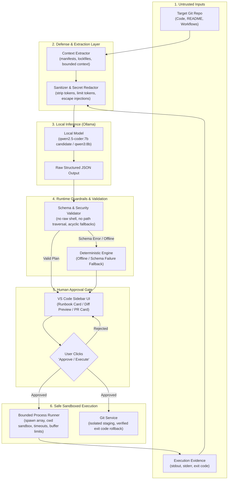

# FirstPR — Complete Project Handoff Context & Technical Source of Truth

> **Target Audience:** Any new LLM agent or human engineer picking up development of FirstPR without prior access to conversation transcripts or scratchpads.  
> **Source-of-Truth Principle:** Code, tests, and configuration files in `/Users/pratyushgupta/Desktop/Winner` are the ultimate ground truth. Historical milestone reports serve as context and recorded evidence, not as assumptions that unverified features still function.  
> **Current Date / Checkpoint:** October 2026 (Milestones 0–11 Complete; Milestone 12 Pending).  
> **Local Git Commit:** `d5ca602e1c95333f20d20d4f20bf82143b8beac5` on branch `main` (Ahead of `origin/main` by 5 commits).

---

## Table of Contents

1. [Executive Handoff](#1-executive-handoff)
2. [Project Origin & Product Evolution](#2-project-origin--product-evolution)
3. [Actual Technology Stack & Development Environment](#3-actual-technology-stack--development-environment)
4. [Architecture & Source-Code Map](#4-architecture--source-code-map)
5. [End-to-End Workflow & Trust Boundaries](#5-end-to-end-workflow--trust-boundaries)
6. [Local Model Selection, Reasoning & Benchmarks](#6-local-model-selection-reasoning--benchmarks)
7. [Safety & Security Contract](#7-safety--security-contract)
8. [Milestone-by-Milestone History (M0 – M12)](#8-milestone-by-milestone-history-m0--m12)
9. [Test, Build & Packaging Verification Record](#9-test-build--packaging-verification-record)
10. [Current Git & Release State](#10-current-git--release-state)
11. [Remaining Work & Exact Next Steps (Milestone 12)](#11-remaining-work--exact-next-steps-milestone-12)
12. [Known Limitations & Open Technical Decisions](#12-known-limitations--open-technical-decisions)
13. [Continuation Instructions for the Next LLM](#13-continuation-instructions-for-the-next-llm)

---

## 1. Executive Handoff

### 1.1 What FirstPR Is and Why It Exists
**FirstPR** is a native Visual Studio Code extension engineered to help beginner open-source developers make their first meaningful code contribution to real-world repositories without falling into the "contribution valley of death."

In open-source software, 80%+ of prospective first-time contributors drop out before submitting a pull request due to:
1. **Hostile Environment Setup:** Inability to configure language runtimes, package managers, virtual environments, native toolchains, databases, and monorepo tooling.
2. **Ambiguous Check Failures:** Terminal error logs (test runner failures, linter errors, typechecker mismatches) that don't explain *why* code failed or how to fix it safely.
3. **Fear of Git & Pull Request Mistakes:** Inability to branch cleanly, isolate modified files from dirty development artifacts, write acceptable commit messages, and open clean pull requests conforming to project guidelines.

FirstPR guides the contributor through a structured, safe, and transparent workflow inside the VS Code sidebar:
$$\text{Clone} \longrightarrow \text{Environment Setup Runbook} \longrightarrow \text{Check Execution} \longrightarrow \text{Evidence Grounded Diagnosis} \longrightarrow \text{Approved Patch Preview} \longrightarrow \text{Re-verification / Rollback} \longrightarrow \text{Isolated Git PR Draft}$$

### 1.2 Target Users & Intended Hackathon Impact
- **Target User:** Junior developers, students, and hackathon participants attempting to contribute to complex multi-technology GitHub repositories.
- **Hackathon Differentiator:** While existing developer assistants hallucinate arbitrary shell commands or send private codebases to remote third-party cloud APIs, FirstPR enforces:
  - **100% Local Inference:** Powered entirely by on-device local models via Ollama. Zero external API keys, zero cloud latency, zero code exfiltration.
  - **Strict Deterministic Guardrails:** Local LLM output is never executed directly. All model responses are validated against strict JSON schemas, checked for path traversal and shell injection, gated behind explicit human approval, and backed by automated rollback mechanisms.
  - **Anti-Hallucination Grounding:** Model diagnoses and PR drafts are strictly constrained to observed disk files, unified diffs, and real terminal exit codes. If verification fails or was skipped, the product refuses to claim success.

### 1.3 Current Overall Status & Immediate Next Action
- **Completed Milestones:** Milestones 1 through 11 are implemented, reviewed, tested, and committed to local `main`.
- **Test Suite Status:** 137 passing automated tests across 21 suites (100% pass rate). Clean TypeScript compilation (`tsc -p ./`), zero warnings. Extension packaging (`vsce ls`) passes.
- **Immediate Next Action:** Execute **Milestone 12** — End-to-End Stress Testing & Final Presentation:
  1. Launch VS Code Extension Development Host.
  2. Validate full interactive UI workflow on the reproducible offline fixture (`fixtures/demo-calc`).
  3. Perform live local model smoke test using the existing on-device Ollama model (`qwen3:8b`).
  4. Perform controlled stress test on a real-world multi-technology repository (`kolibri`).
  5. Package extension (`.vsix`) and prepare demo script.
  6. Push commits to `origin/main` upon explicit user review.

### 1.4 What a New LLM Must Understand Before Touching Code
1. **Never Bypass Human Approval:** FirstPR’s core security promise is that the extension will *never* execute an unapproved shell command, modify files without an approved diff preview, or switch Git branches / stage files without confirmation.
2. **Never Execute Raw Shell Strings:** Executables and argument arrays are separated everywhere (`spawn(step.executable, step.args)`). Shell interpolation (`sh -c`, `cmd.exe /c`, `shell: true`, `&&`, `|`, `;`) is strictly prohibited.
3. **Preserve Deterministic Fallbacks:** Whenever Ollama is unreachable, returns malformed JSON, or hallucinates schema violations, FirstPR falls back smoothly to deterministic rule-based engines (`setupGenerator.ts`, `diagnosticEngine.ts`, `prDraftGenerator.ts`). The extension must remain 100% usable offline.
4. **Do Not Push to Remote Automatically:** Pushes to GitHub remote (`origin/main`) require explicit human authorization.

---

## 2. Project Origin & Product Evolution

### 2.1 The Original Concept (Milestones 1–5)
FirstPR started as a purely deterministic VS Code extension:
- Validated public GitHub repository URLs (`https://github.com/owner/repo`).
- Cloned the repository into a safe workspace directory (`~/firstpr-workspace`).
- Inspected `package.json` to detect Node.js package managers (`npm`, `yarn`, `pnpm`) and run test scripts (`npm test`).
- Parsed terminal error outputs (e.g., Jest/Node test runner assertion failures) using regex heuristics.
- Proposed single-line fixes, showed diffs in the sidebar, applied patches, re-ran checks, and offered automatic rollback if tests still failed.
- Prepared safe feature branches (`firstpr/fix-...`), staged only approved files, committed with formatted messages, and opened GitHub Compare URLs in the browser.

### 2.2 The Real-World Reality Check: The Kolibri Repository (Milestone 6A)
During intermediate hackathon evaluation, the deterministic model was tested against a real, multi-technology open-source repository: [TheGreatPratyush/kolibri](https://github.com/TheGreatPratyush/kolibri).

The test immediately broke at the inspection/setup phase:
```text
pnpm: command not found
```
**Why the original concept failed on real repositories:**
1. **Complex Toolchains:** Real repositories do not use standard `npm install`. They require `pnpm` workspaces, specific Node.js versions (e.g. Node 18 vs 22), Python virtual environments, `pip` dependencies, system packages, build tools, or Git submodules.
2. **Multi-Step Setup Runbooks:** A developer must read `README.md`, `CONTRIBUTING.md`, or `.github/workflows` to discover the exact prerequisite sequence.
3. **Ambiguous Error Traces:** Real test failures are rarely simple single-line regex matches; they involve multi-file stack traces, missing environment variables, or build artifact issues.

### 2.3 Strategic Pivot to a Local-LLM Repository Agent (Milestones 6–12)
The hackathon judges suggested using an LLM to analyze repositories, generate dynamic setup runbooks, guide diagnosis, and prepare pull requests.

Crucially, the architecture was designed with a **Local-First, Guardrailed Agent** paradigm:
- **Local LLM Only:** Use local Ollama running on developer hardware (Apple Silicon M4).
- **No Direct Agent Execution:** The LLM does *not* possess an autonomous shell loop. Instead, the LLM emits a strictly typed, schema-validated JSON plan.
- **Human-in-the-Loop Gate:** The extension translates the JSON plan into interactive UI cards in VS Code. Every setup command, every patch application, and every Git branch operation requires a physical button click by the developer.



---

## 3. Actual Technology Stack & Development Environment

### 3.1 Workspace & Git Repositories
- **FirstPR Development Workspace:** `/Users/pratyushgupta/Desktop/Winner`
- **FirstPR Remote GitHub Repository:** `https://github.com/TheGreatPratyush/Hack`
- **Real-World Test Target Repository:** `https://github.com/TheGreatPratyush/kolibri`
- **Local Destination for Target Clones:** `/Users/pratyushgupta/Desktop/demo` (or default `~/firstpr-workspace/`)

### 3.2 Host Platform & Hardware (Verified October 2026)
- **Host OS:** macOS (Darwin 26.6.1 / Apple Silicon)
- **Hardware (Reported in M6/M7 Audits):** Apple MacBook Pro M4 (10-core CPU), 16 GB unified memory, ~209 GB free SSD storage.
- **Node.js Runtime (Verified):** `v22.23.1`
- **Package Manager (Verified):** `npm` `10.9.8`
- **Git Version (Verified):** `git version 2.39.5 (Apple Git-154)`
- **TypeScript Compiler (Verified):** `Version 5.4.5`
- **VS Code Extension Engine:** `^1.85.0` (`@types/vscode: ^1.85.0`)
- **Test Runner:** Native Node.js Test Runner (`node --test out/test/**/*.test.js`), zero third-party test dependencies.

### 3.3 Local Ollama Environment (Verified October 2026)
- **Ollama CLI Location (Verified):** `/usr/local/bin/ollama`
- **Ollama Local Endpoint:** `http://127.0.0.1:11434`
- **Locally Cached Models (`ollama list` Verified):**
  - `qwen3:8b` (ID: `500a1f067a9f`, Size: 5.2 GB, Modified: ~8 weeks ago).
- **Target Candidate Model:** `qwen2.5-coder:7b` (selected as the ideal default for coding/schema adherence; *not downloaded yet pending approval*).
- **Rejected Models:** `qwen3-coder:30b` was evaluated during M6 and explicitly rejected due to exceeding 16 GB unified RAM limits.
- **Ollama Daemon Status:** Responds on `http://127.0.0.1:11434/api/tags`.

### 3.4 Build, Compile & Test Commands
All commands run from repository root `/Users/pratyushgupta/Desktop/Winner`:
```bash
# 1. Compile TypeScript cleanly to /out directory
npm run compile

# 2. Run entire test suite (137 tests across 21 suites)
npm test

# 3. Verify extension packaging without creating .vsix
npx @vscode/vsce ls

# 4. Package extension for local distribution
npx @vscode/vsce package
```

---

## 4. Architecture & Source-Code Map

Every module listed below exists in `/Users/pratyushgupta/Desktop/Winner` and has been verified against the physical filesystem.

```
/Users/pratyushgupta/Desktop/Winner/
├── package.json                   # Extension manifest, contributes views, scripts
├── tsconfig.json                  # Target ES2022, CommonJS, strict mode, outDir out/
├── PROJECT_STATUS.md              # Milestone-by-milestone progress log
├── media/
│   └── icon.svg                   # FirstPR activity bar icon
├── fixtures/
│   └── demo-calc/                 # Reproducible offline calculator fixture
│       ├── package.json           # npm test script with failing assertion
│       ├── src/calc.js            # Buggy arithmetic code
│       └── test/calc.test.js      # Unit tests
└── src/
    ├── extension.ts               # Extension activate(), registers sidebar & commands
    ├── analysis/                  # Milestone 10: LLM Bug Diagnosis & Fixes
    │   ├── types.ts               # Diagnostic failure categories & interface contracts
    │   ├── diagnosisEngine.ts     # Failure classifier, bounded context extractor, patch proposer
    │   └── index.ts               # Re-exports analysis module
    ├── core/                      # Milestones 1–2: Foundation Core
    │   ├── checkRunner.ts         # Bounded process runner with timeout & cancellation
    │   ├── gitService.ts          # Git repository cloning, branch listing, status
    │   ├── projectInspector.ts    # package.json and project structure inspector
    │   ├── urlValidator.ts        # GitHub URL parsing, HTTPS validation, metacharacter defense
    │   └── workspaceManager.ts    # Safe destination path calculation & cleanup
    ├── diagnostics/               # Milestone 3: Deterministic Diagnostics
    │   └── diagnosticEngine.ts    # Rule-based failure parsing & card generation
    ├── fixes/                     # Milestone 4: Fix Application & Rollback
    │   └── fixEngine.ts           # Unified diff generation, atomic patch apply, rollback records
    ├── git/                       # Milestones 5 & 11: Git Branching & PR Preparation
    │   ├── prService.ts           # Branch creation, preflight checks, isolated staging, gh CLI
    │   ├── prDraftGenerator.ts    # Evidence extraction, secret redaction, schema validator, compare URLs
    │   └── index.ts               # Re-exports git module
    ├── llm/                       # Milestone 7: Provider-Independent Local LLM Client
    │   ├── types.ts               # Plan schema types, LlmClient interface, LlmError
    │   ├── planValidator.ts       # Runtime schema validator, traversal & shell-injection defense
    │   ├── ollamaClient.ts        # Ollama HTTP API adapter with fetch, timeout, size limits
    │   └── index.ts               # Re-exports llm module
    ├── setup/                     # Milestones 8 & 9: Repository Runbook & Setup Agent
    │   ├── types.ts               # Context, runbook, step status, execution state interfaces
    │   ├── contextExtractor.ts    # Manifest & lockfile parser, injection filtering, doc extractor
    │   ├── setupGenerator.ts      # setup.md runbook generator with deterministic baseline
    │   ├── setupAgent.ts          # Safe step executor, process boundary checks, fallback recovery
    │   └── index.ts               # Re-exports setup module
    ├── ui/                        # Native VS Code Webview Sidebar
    │   └── SidebarProvider.ts     # HTML renderer, message dispatchers, UI state handlers
    └── test/                      # 16 Test Suites (137 tests total)
        ├── checkRunner.test.ts
        ├── demoPipeline.test.ts
        ├── diagnosisEngine.test.ts
        ├── diagnosticEngine.test.ts
        ├── endToEndFixPipeline.test.ts
        ├── endToEndPrPipeline.test.ts
        ├── fixEngine.test.ts
        ├── gitService.test.ts
        ├── llmClient.test.ts
        ├── prDraftGenerator.test.ts
        ├── prService.test.ts
        ├── projectInspector.test.ts
        ├── setupAgent.test.ts
        ├── setupGenerator.test.ts
        ├── urlValidator.test.ts
        └── workspaceManager.test.ts
```

### 4.1 Detailed Module Descriptions & Public Interfaces

#### `src/core/urlValidator.ts`
- **Responsibility:** Sanitizes user input before passing to Git CLI.
- **Key Functions:**
  - `validateGitHubUrl(url: string): { isValid: boolean; normalizedUrl?: string; error?: string }`
  - `parseGitHubRepo(url: string): { owner: string; repo: string } | null`
- **Security Invariant:** Rejects shell metacharacters (`` ` ``, `$`, `&`, `|`, `;`, `>`, `<`), non-GitHub domains, missing repo/owner names, and non-HTTPS protocols.

#### `src/core/workspaceManager.ts`
- **Responsibility:** Calculates safe destination paths under `~/firstpr-workspace/` or custom root.
- **Key Functions:**
  - `computeDestinationPath(repoUrl: string, baseDir?: string): string`
  - `safeCleanupDirectory(targetPath: string, rootDir: string): Promise<boolean>`
- **Security Invariant:** Sanitizes directory names against path traversal (`..`, `/`) and refuses to delete directories outside the designated root.

#### `src/core/checkRunner.ts`
- **Responsibility:** Executes terminal checks (e.g. `npm test`, `npm run lint`) safely.
- **Key Functions:**
  - `runCheck(options: CheckOptions): Promise<CheckResult>`
- **Security Invariant:** Separates command and arguments into string arrays; never uses `shell: true`; enforces execution timeout (default 30s) and bounds output capture to 64 KB to prevent memory exhaustion.

#### `src/llm/planValidator.ts` & `src/llm/ollamaClient.ts`
- **Responsibility:** Local LLM communication and strict runtime schema enforcement.
- **Key Functions:**
  - `validateSetupPlan(raw: unknown): PlanValidationResult`
  - `class OllamaClient implements LlmClient`: `checkHealth()`, `listModels()`, `generateSetupPlan()`
- **Security Invariant:** Rejects raw shell strings, metacharacters in executables, absolute or escaping paths in `cwd`, and cyclic fallback chains (e.g., $A \to B \to A$). Limits response size to 512 KB.

#### `src/setup/contextExtractor.ts` & `src/setup/setupAgent.ts`
- **Responsibility:** Gathers repository facts without prompt injection risks and executes approved setup steps.
- **Key Functions:**
  - `extractRepositoryContext(repoRoot: string): Promise<RepositoryContext>`
  - `executeSetupStep(step: SetupStep, repoRoot: string, options?: SetupExecutionOptions): Promise<StepExecutionResult>`
- **Security Invariant:** Enforces strict human approval (`requiresApproval: true`). Validates relative paths against directory escapes and symlinks. Captures non-zero exit codes and suggests non-auto-executing recovery fallbacks.

#### `src/analysis/diagnosisEngine.ts`
- **Responsibility:** Categorizes check failures and generates grounded fix proposals.
- **Key Functions:**
  - `classifyFailure(checkResult: CheckResult): FailureClassification`
  - `class LlmDiagnosisEngine`: `diagnoseAndProposeFix(checkResult: CheckResult): Promise<DiagnosisResult>`
- **Security Invariant:** Grounding validation: target file must exist on disk, line numbers must be within file range, and original snippet must be an exact substring match. Prevents phantom file hallucinations.

#### `src/fixes/fixEngine.ts`
- **Responsibility:** Diffs, atomic patching, and rollback tracking.
- **Key Functions:**
  - `proposeFix(filePath: string, originalCode: string, fixedCode: string): ProposedFix`
  - `applyProposedFix(fix: ProposedFix, repoRoot: string): Promise<AppliedFixRecord>`
  - `rollbackAppliedFix(record: AppliedFixRecord, repoRoot: string): Promise<boolean>`
- **Security Invariant:** Calculates SHA-256 hashes of pre-patch file states. If file on disk has changed since diagnosis (stale diff), patch application is aborted.

#### `src/git/prDraftGenerator.ts` & `src/git/prService.ts`
- **Responsibility:** Git branch creation, isolated staging, secret redaction, PR drafting, and GitHub Compare URLs.
- **Key Functions:**
  - `redactSensitiveContent(text: string): string`
  - `validatePrDraftPayload(raw: unknown, evidence: FactualPrEvidence): PrDraftValidationResult`
  - `generateEvidenceBackedPrDraft(evidence: FactualPrEvidence, llmClient?: LlmClient): Promise<StructuredPrDraft>`
  - `commitVerifiedFix(repoRoot: string, branchName: string, commitTitle: string, commitBody: string, approvedFiles: string[])`
- **Security Invariant:** Staging isolation: only explicitly approved files are staged via `git add -- <file>`. Unrelated modified files in the working directory remain untouched. Redacts API tokens and private keys. Anti-hallucination guardrail forbids claims of passed verification if exit code $\ne 0$.

---

## 5. End-to-End Workflow & Trust Boundaries

The FirstPR workflow consists of 15 sequential stages. Every stage maintains an explicit trust boundary.

| Stage # | Stage Name | Primary Modules | Trust Boundary & Security Control | Verification Status |
| :---: | :--- | :--- | :--- | :---: |
| **1** | Accept GitHub URL | `SidebarProvider.ts` | Webview input is treated as untrusted user text. | Tested in Unit & UI |
| **2** | Validate & Clone | `urlValidator.ts`, `gitService.ts`, `workspaceManager.ts` | Rejects shell metacharacters and non-HTTPS URLs. Clones into isolated path. | Tested in Unit & Fixture |
| **3** | Inspect Repository | `projectInspector.ts`, `contextExtractor.ts` | Reads manifests/lockfiles safely; ignores hidden/sensitive files (`.env`, `.git`). | Tested in Unit & Monorepo |
| **4** | Collect Bounded Evidence | `contextExtractor.ts` | Strips prompt-injection patterns (`Ignore previous instructions`), truncates doc size to 2000 chars. | Tested in Unit Suite |
| **5** | Local LLM Plan Generation | `ollamaClient.ts`, `planValidator.ts` | Schema validation enforces separate executable & argument arrays; forbids shell characters. | Tested in Unit & Mock LLM |
| **6** | Generate `setup.md` | `setupGenerator.ts` | If Ollama is offline or schema is invalid, generates deterministic baseline runbook. | Tested in Unit & Fallback |
| **7** | Request Setup Step Approval | `SidebarProvider.ts` | UI displays step command, cwd, risk level. **Requires physical user click.** | Tested in UI Unit |
| **8** | Execute Approved Step | `setupAgent.ts`, `checkRunner.ts` | Bounded execution (timeout 120s, buffer 128 KB, no `shell: true`). Proposes recovery step on failure. | Tested in Unit Suite |
| **9** | Run Checks & Classify | `checkRunner.ts`, `diagnosisEngine.ts` | Categorizes into environment, dependency, assertion, or source defect. | Tested in Unit Suite |
| **10** | Evidence-Grounded Diagnosis | `diagnosisEngine.ts` | Grounds LLM on terminal output + disk context. Verifies file and snippet exist. | Tested in Unit Suite |
| **11** | Generate Diff Preview | `fixEngine.ts` | Generates standard unified diff with pre-patch SHA-256 hash. | Tested in Unit Suite |
| **12** | Human Patch Approval | `SidebarProvider.ts` | UI renders diff. Patch cannot touch disk without explicit click. | Tested in UI Unit |
| **13** | Apply & Re-verify / Rollback | `fixEngine.ts`, `checkRunner.ts` | Applies patch atomically. Runs verification command. If exit code $\ne 0$, rolls back to original hash. | Tested in Unit Suite |
| **14** | Factual PR Draft | `prDraftGenerator.ts` | Redacts secrets; enforces strict length limits; rejects hallucinations claiming verification passed on failure. | Tested in Unit Suite |
| **15** | Git Feature Branch & Compare URL | `prService.ts` | Preflight check; creates `firstpr/fix-...`; stages **only** approved files; builds browser compare URL. | Tested in Unit Suite |

---

## 6. Local Model Selection, Reasoning & Benchmarks

### 6.1 The Decision for 100% Local Inference
During the Milestone 6 evaluation, the team evaluated whether to use a cloud API (Gemini, OpenAI, Claude) or local inference. The decision was made to use **Local Ollama Only** for four reasons:
1. **Developer Privacy & Trust:** Open-source contributors often work with uncommitted, proprietary, or sensitive local code. Sending full project trees to external APIs creates enterprise resistance.
2. **Offline Accessibility:** Hackathons, flights, and constrained networks require an assistant that functions with zero internet access.
3. **Reproducibility:** A local Ollama model running on fixed hardware guarantees reproducible prompt performance.
4. **Zero API Cost:** New contributors cannot be asked to provide paid API keys.

### 6.2 Host Machine & Model Candidates Audited
- **Host Spec:** Apple MacBook Pro M4, 16 GB unified memory, macOS Darwin.
- **Model Evaluations:**
  - `qwen3-coder:30b` (Q4): **REJECTED.** Requires ~18.5 GB RAM, exceeding the physical 16 GB unified memory limit. Would cause heavy disk swap and freeze the VS Code host.
  - `qwen2.5-coder:7b` (Q4_K_M, ~4.7 GB): **SELECTED AS DEFAULT CANDIDATE.** Fits comfortably within 16 GB RAM with ~10 GB headroom for VS Code and development servers. Proven superior instruction-following and JSON schema adherence for code. *Status: Not downloaded yet pending user approval.*
  - `qwen3:8b` (Q4_K_M, 5.2 GB): **CACHED BASELINE.** Already installed in `/usr/local/bin/ollama` (`500a1f067a9f`). Available as immediate baseline without network activity.

### 6.3 Live On-Device Benchmark Findings (Historical Context from M7)
During Milestone 7, a live smoke test was conducted against the cached `qwen3:8b` model running on the M4 host:
- **Execution Time:** ~22.5 seconds for setup plan generation.
- **Behavior Observed:** The general-purpose conversational model attempted to emit `cwd: "/"` and conflated prerequisite check fields with executable step fields.
- **Critical Architectural Lesson:** The runtime validator `validateSetupPlan` caught the invalid `cwd` and rejected the plan, saving the system from an illegal filesystem operation. This proved that **LLM output cannot be trusted without a programmatic schema barrier**, and confirmed `qwen2.5-coder:7b` as the preferred candidate for code-specific tasks.

### 6.4 Offline Fallback Architecture
If the local model daemon is not running, times out, or emits invalid JSON, FirstPR activates deterministic fallback engines:
- For Setup: `generateDeterministicBaselinePlan()` in `setupGenerator.ts`.
- For Diagnosis: `diagnoseCheckResult()` in `diagnosticEngine.ts`.
- For PR Drafting: `generateDeterministicPrDraft()` in `prDraftGenerator.ts`.
In all fallback scenarios, the user is notified via sidebar cards that deterministic templates were used.

---

## 7. Safety & Security Contract

Every future modification to FirstPR must adhere to this security matrix:

| Security Rule | Attack Vector Mitigated | Enforcing Module | Verification Test |
| :--- | :--- | :--- | :--- |
| **No Shell String Interpolation** | Arbitrary command execution via `; rm -rf /` or `& calc.exe` | `checkRunner.ts`, `setupAgent.ts`, `planValidator.ts` | `src/test/llmClient.test.ts`, `src/test/setupAgent.test.ts` |
| **Separated Executable & Args** | Flag injection and argument hijacking | `setupAgent.ts` (`spawn(step.executable, step.args)`) | `src/test/setupAgent.test.ts` |
| **Path Traversal & Symlink Defense** | Escaping repo root to overwrite system files (`../../etc/passwd`) | `workspaceManager.ts`, `planValidator.ts`, `setupAgent.ts` | `src/test/workspaceManager.test.ts`, `src/test/setupAgent.test.ts` |
| **Prompt Injection Filtering** | Malicious README or issue comments hijacking model instructions | `contextExtractor.ts` (strips override phrases, bounds length) | `src/test/setupGenerator.test.ts` |
| **Secret & Credential Redaction** | Leaking GitHub PATs, AWS keys, or private SSH keys into PR drafts | `prDraftGenerator.ts` (`redactSensitiveContent`) | `src/test/prDraftGenerator.test.ts` |
| **Git Staging Isolation** | Unintentionally staging or committing unrelated dirty files | `prService.ts` (`commitVerifiedFix`) | `src/test/prService.test.ts`, `src/test/prDraftGenerator.test.ts` |
| **Stale-Diff & File Hash Checks** | Applying patches to modified or moving target files | `fixEngine.ts` (pre-patch SHA-256 validation) | `src/test/fixEngine.test.ts`, `src/test/diagnosisEngine.test.ts` |
| **Anti-Hallucination Exit Codes** | Model falsely claiming a bug fix worked when tests failed | `prDraftGenerator.ts` (`validatePrDraftPayload`) | `src/test/prDraftGenerator.test.ts` |
| **Mandatory Human Approval** | Autonomous unintended writes or command executions | `SidebarProvider.ts` (explicit webview events required) | `src/test/setupAgent.test.ts`, `src/test/diagnosisEngine.test.ts` |
| **Local Inference Sandbox** | Exfiltrating code to remote third-party cloud APIs | `ollamaClient.ts` (restricted to `127.0.0.1:11434`) | `src/test/llmClient.test.ts` |

---

## 8. Milestone-by-Milestone History (M0 – M12)

The table below summarizes all milestones from project inception through the current state:

| Milestone | Title | Status | Git Commit Hash | Passing Tests | Core Deliverable |
| :---: | :--- | :---: | :---: | :---: | :--- |
| **M1** | Extension Foundation | `COMPLETE` | `017c3de` | 23 | Extension manifest, sidebar container, URL validation, safe workspace clone. |
| **M2** | Inspection & Checks | `COMPLETE` | `0fb99f8` | 42 | Package.json inspection, bounded check runner, timeout and process limits. |
| **M3** | Diagnostic Engine & Fixture | `COMPLETE` | `6308f7c` | 52 | Evidence-to-issue heuristics, reproducible `fixtures/demo-calc` fixture. |
| **M4** | Safe Fix Proposal & Rollback | `COMPLETE` | `050eb6d` | 61 | Unified diff preview, atomic patching, re-verification, automatic rollback. |
| **M5** | Git Branching & PR Preparation | `COMPLETE` | `df96d47` | 76 | Safe branch creation, isolated staging, PR compare URL generation, gh CLI check. |
| **M6** | Architecture Pivot & Model Audit | `COMPLETE` | *(Report only)* | 76 | Local LLM pivot, host hardware audit (M4 16GB), candidate selection (`qwen2.5-coder:7b`). |
| **M7** | Local LLM Client & Plan Validator | `COMPLETE` | `f21a3df` | 103 | Provider-independent `LlmClient`, strict schema validator, Ollama HTTP client. |
| **M8** | Context Extraction & `setup.md` | `COMPLETE` | `2cda7e5` | 109 | Monorepo/lockfile context extractor, prompt defense, `setup.md` generator. |
| **M9** | Safe Setup Execution Agent | `COMPLETE` | `c3418be` | 119 | Human-gated step executor, process bounds, directory sandboxing, fallback recovery. |
| **M10** | LLM Diagnosis & Verified Fixes | `COMPLETE` | `f948dc2` | 129 | Failure classifier, grounded LLM diagnosis, approval gate, verified re-check. |
| **M11** | Evidence-Backed PR Preparation | `COMPLETE` | `d5ca602` | 137 | Factual PR context extraction, secret redaction, schema validation, isolated staging. |
| **M12** | Stress Testing & Hackathon Demo | `PENDING` | *(Upcoming)* | *(Target 137+)* | Live Extension Host validation, demo-calc fixture run, Ollama smoke test, packaging. |

---

## 9. Test, Build & Packaging Verification Record

### 9.1 Historical Reported Progression
- **After M5:** 76 passing tests (15 suites)
- **After M7:** 103 passing tests (17 suites)
- **After M8:** 109 passing tests (18 suites)
- **After M9:** 119 passing tests (19 suites)
- **After M10:** 129 passing tests (20 suites)
- **After M11:** 137 passing tests (21 suites)

### 9.2 Current Verified Test Execution (Verified October 2026)
Executing `npm test` on `/Users/pratyushgupta/Desktop/Winner`:
```text
ℹ tests 137
ℹ suites 21
ℹ pass 137
ℹ fail 0
ℹ cancelled 0
ℹ skipped 0
ℹ todo 0
ℹ duration_ms 2237.91275
```
- **Unit vs. Live Tests:** Unit tests in `src/test/` use mocked responses for network calls and Ollama HTTP endpoints. This ensures fast, deterministic CI execution without depending on a running daemon.
- **Live Local Inference Testing:** One live test was conducted in M7 against `qwen3:8b`. A full live end-to-end test on the actual UI is part of Milestone 12.
- **Compilation Check:** `npm run compile` (`tsc -p ./`) exits with code `0` and generates clean outputs into `out/`.
- **Packaging Check:** `npx @vscode/vsce ls` executes with code `0`, confirming all required runtime assets, icons, and transpiled files are present without extraneous build artifacts.

---

## 10. Current Git & Release State

### 10.1 Branch & Remote Synchronization
- **Current Branch:** `main`
- **Remote Tracking:** `origin/main` (`https://github.com/TheGreatPratyush/Hack`)
- **Remote Head:** `df96d47d2c6729a2de4f1f45b650a5433dd54d34` (Milestone 5)
- **Local Head:** `d5ca602e1c95333f20d20d4f20bf82143b8beac5` (Milestone 11)
- **Ahead Commit Count:** 5 commits ahead of `origin/main`:
  1. `f21a3df` — feat: add provider-independent local LLM client interface and setup plan validator
  2. `2cda7e5` — feat: add repository context extraction, injection defense, and setup.md generator
  3. `c3418be` — feat: add safe setup execution agent with user approval gating, preflight checks, and fallback recovery
  4. `f948dc2` — feat: add evidence-backed failure classification, grounded diagnosis engine, and verification workflow
  5. `d5ca602` — feat: add evidence-backed PR draft generator with secret redaction and Git isolation

### 10.2 Working Tree Status
- Working tree is clean prior to creating this handoff file.
- **Safety to Push Assessment:** All 137 unit and integration tests pass, TypeScript compiles with zero errors, packaging is verified, and staging isolation guarantees no secrets or dirty workspace files are committed. **The repository is technically safe to push.** However, per project rules, **pushing to remote is withheld until explicit human review.**

---

## 11. Remaining Work & Exact Next Steps (Milestone 12)

Milestone 12 is the final phase before hackathon presentation. The objective is to validate the completed codebase through real execution, package the release, and prepare presentation collateral.

### 11.1 The 10-Step Execution Plan for Milestone 12
1. **Confirm Baseline:** Verify clean working tree, 137 passing tests, and TypeScript build.
2. **Launch Extension Development Host:** Open the extension in a secondary VS Code window (`F5` or `code --extensionDevelopmentPath=.`).
3. **Controlled Offline Fixture Run:**
   - Load `fixtures/demo-calc`.
   - Trigger inspection, execute `npm test` check.
   - Verify failure card renders in the sidebar with observed evidence.
   - Preview proposed fix, click "Apply Fix", verify test re-run passes (exit code 0).
   - Test "Prepare Pull Request", verify clean feature branch creation and compare URL.
4. **Live Local Model Smoke Test:**
   - Verify local Ollama daemon is active (`http://127.0.0.1:11434`).
   - Run setup plan generation using the locally available `qwen3:8b` model.
   - Verify `validateSetupPlan` passes and sidebar displays the interactive setup runbook.
5. **Controlled Real-Repository Test (Kolibri):**
   - Ingest `/Users/pratyushgupta/Desktop/demo` (`kolibri` clone).
   - Verify context extractor captures `pnpm-workspace.yaml`, Python requirements, and Node manifests.
   - Verify FirstPR warns about missing `pnpm` rather than crashing.
6. **Verify Safety Invariants in UI:**
   - Attempt to reject a setup step; verify the agent does not execute it.
   - Simulate a failed fix verification; verify the rollback button restores disk state.
7. **Fix Release-Blocking Defects Only:** If UI message-passing or state synchronization bugs are encountered, apply minimal targeted fixes.
8. **Final Compilation & Package Build:**
   - Run `npm run compile` and `npm test`.
   - Run `npx @vscode/vsce package` to produce `firstpr-0.0.1.vsix`.
9. **Capture Demo & Presentation Assets:**
   - Record screenshots of sidebar states: Setup Runbook, Failure Card, Diff Preview, Re-verification Badge, and PR Submission Card.
   - Prepare a 3-minute hackathon pitch script highlighting the local-LLM + safety guardrails story.
10. **Final Push Decision:** Present final report to user and obtain authorization to push commits `f21a3df..d5ca602` to `origin/main`.

---

## 12. Known Limitations & Open Technical Decisions

1. **Model Download Decision:**
   - `qwen2.5-coder:7b` is the recommended default, but requires downloading ~4.7 GB.
   - `qwen3:8b` is already present locally (5.2 GB).
   - *Decision:* For immediate demo/testing, use `qwen3:8b` or mock fallback. Do NOT download `qwen2.5-coder:7b` without user sign-off.
2. **VS Code Webview State Persistence:**
   - The sidebar uses `vscode.postMessage` between Webview and extension.
   - Complex multi-step states (e.g., halfway through setup runbook) are stored in memory; refreshing the webview resets the card view. Persisting state to `workspaceState` is a post-hackathon enhancement.
3. **Target Repository Tooling Dependencies:**
   - FirstPR runs setup steps using local binaries installed on the host. If a repository requires `pnpm` or `python3` and the user's host does not have them installed, FirstPR identifies the missing tool and halts safely. It does *not* attempt to install system package managers (e.g. `brew install`) without explicit user intervention.
4. **Remote Branch Pushing:**
   - `prService.ts` prepares branches and commits locally. Automatic `git push` to GitHub is deliberately withheld so users can inspect their local Git tree before publishing.

---

## 13. Continuation Instructions for the Next LLM

```text
================================================================================
          CONTINUATION INSTRUCTIONS FOR THE NEXT LLM AGENT
================================================================================

1. SOURCE OF TRUTH:
   - Treat /Users/pratyushgupta/Desktop/Winner/FIRSTPR_COMPLETE_CONTEXT.md as the
     canonical handoff document.
   - Always verify facts against actual filesystem files, tests, and Git status
     before executing tasks. Never rely on assumptions.

2. PRESERVE CORE CONSTRAINTS:
   - 100% LOCAL INFERENCE ONLY. Never add remote cloud LLM endpoints or APIs.
   - ZERO UNAPPROVED EXECUTION. Never execute shell commands or apply patches
     without explicit human approval.
   - NO SHELL CONCATENATION. Always use string arrays for executables and args.
   - NO FORCED PUSHES OR AUTOMATIC COMMITS TO TARGET REPOSITORIES.
   - DO NOT DOWNLOAD MODELS without explicit user approval.

3. IMMEDIATE TASK: MILESTONE 12
   - Do NOT re-architect completed modules (M1–M11 are complete and tested).
   - Focus strictly on Milestone 12: Extension Development Host verification,
     interactive UI testing on fixtures, packaging, and demo collateral.

4. WORKFLOW FOR NEXT AGENT:
   - Step 1: Briefly state the immediate goal.
   - Step 2: Perform bounded, focused actions.
   - Step 3: Run 'npm test' and 'npm run compile' to verify zero regressions.
   - Step 4: Report findings with concrete test counts and Git hashes.
   - Step 5: Ask for user authorization before any remote Git pushes.

================================================================================
```
